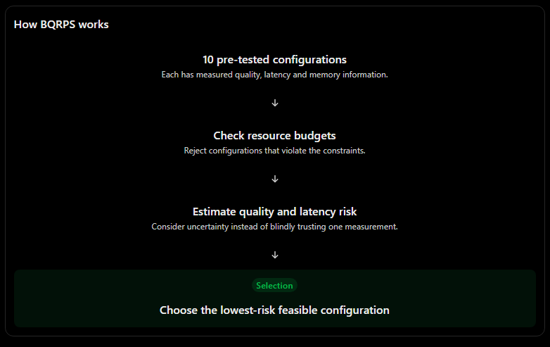
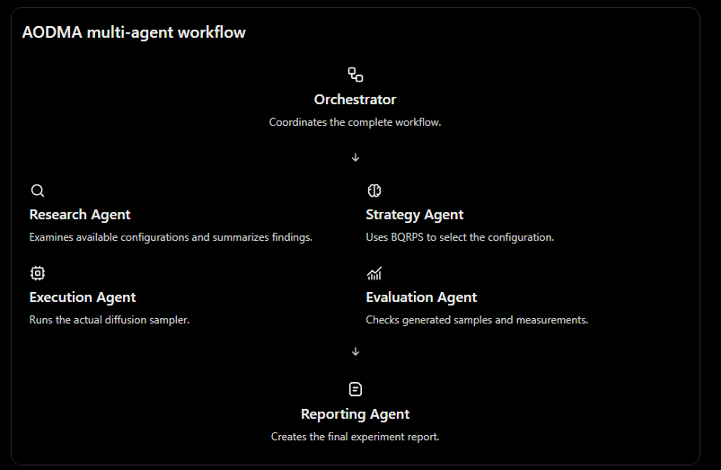

Imagine you're building a smart system that knows how to generate images, understands how much time and computer power each method needs, and automatically chooses the best way to generate images within a given budget.

**That's essentially what AODMA is trying to achieve.**

Let me explain what we've built, step by step.

# **1. First, we built our own image-generation engine**

Before optimizing anything, we needed something that could actually generate images.

We built a small diffusion model and trained it using two datasets:

- MNIST – handwritten digits.
- CIFAR-10 – everyday objects like cars, animals, ships, etc.

Think of a diffusion model like an artist who starts with a completely noisy image and gradually removes noise until a recognizable image appears.

[Vizuara AI Pods — Learn AI from First Principles](https://images.openai.com/static-rsc-4/yZhTOQaKSGMXCMGE7ISByatP6LplT_TKcGWsTVyM26yFG51w7VGAbIg4zkxe0Why0OqAOzSPdyLcgAFZTWwxLIbtRI5vsZuVabOzGrjqZNzRLrQmfWVaoZvIgrOnIBqWHP2tVVPSPvMwQBQeffgX76yDtGO3scES-TqP6scul1I?purpose=inline)

[Diffusion Models from scratch (MNIST data) | Tutorial in 100 lines of PyTorch code | by Papers in 100 Lines of Code | Medium](https://images.openai.com/static-rsc-4/TbR1Pv3M61w2GKiKFBG4D0-6FPBO0TOMykUeky1KAeA_srAnNLszwbnNjmHRYzzCKS1cVEN7ixtQqGog-amKV9WlDskcyHZoYwT8mCB8NHDcAkDKYRw3wRhuGNuIA2ub6-pjPmdKs8vQBzoszCnlE9a_Hrh7WdMA28eSqCtxQvM?purpose=inline)

[Score-Based Generative Modeling with Critically-Damped Langevin Diffusion](https://images.openai.com/static-rsc-4/0plFulcp2wCpQvZUEs56WxKa9UrKmqn-ctM_wpYrxUlwbOg8ixHY1oNJcLrg-BzbeQTcyiEr-SbZtHtcubeLwoyFIwd03sVngx7oH9Qb7QaaVQM_c6gU88K2VU6lzccFOlyHSOTPD7NxudwpwoWJHIdLuu9VYfx9mNjBLuMIaDw?purpose=inline)

5

We implemented four different ways of removing that noise:

| Method     | Simple explanation                                 |
| ---------- | -------------------------------------------------- |
| DDPM       | Gradually removes noise through many steps.        |
| DDIM       | Can generate images using fewer steps.             |
| DPM-Solver | Uses numerical techniques to speed up the process. |
| UniPC      | Uses another advanced numerical sampling strategy. |

**Why did we do this?**

Because we wanted to compare different ways of generating images and understand which methods offer the best balance between quality and speed.

# **2. Then we conducted experiments**

Imagine asking four people to draw the same picture.

One person takes 10 minutes, another takes 5 minutes, but the person who takes 10 minutes might produce a better drawing.

That's the exact trade-off we wanted to investigate.

We measured two important things:

**A. How long does image generation take?**

We measured the time taken by different sampling methods.

For example, in our MNIST pilot:

| Method | Steps | Time          |
| ------ | ----- | ------------- |
| DDPM   | 1000  | 13.06 seconds |
| DDIM   | 10    | 0.106 seconds |
| DDIM   | 20    | 0.217 seconds |
| DDIM   | 50    | 0.698 seconds |

DDIM with 10 steps was approximately 123 times faster than DDPM in that particular experiment.

**B. How good are the generated images?**

We used two measurements:

- **FID:** Measures how closely the generated image distribution resembles real images.
- **KID:** Another statistical measure of similarity between generated and real image distributions.

Our CIFAR-10 experiments showed that DDIM with 50 steps produced a lower FID than DDIM with 10 steps.

That means fewer steps were faster, but more steps generally gave better image-distribution quality in our reported results.

This created our central problem:

**How can we automatically choose a good configuration without exceeding available computing resources?**

# **3. This is where BQRPS comes in**

Our intended core research contribution

BQRPS stands for:

**Budgeted Quality-Risk Portfolio Selection.**

Forget the name for a moment.

Imagine you have 10 different image-generation configurations.

Each configuration has:

- A particular image quality.
- A particular generation time.
- A particular memory requirement.
- A particular number of sampling steps.

Now imagine a user gives the system these requirements:

- Generate images quickly.
- Don't exceed 500 milliseconds of latency.
- Don't exceed a particular memory limit.
- Don't exceed 20 sampling steps.

Which configuration should we choose?

A simple system might always choose the fastest one.

But that isn't necessarily the best choice.

Another system might always choose the configuration with the best image quality, even if it takes too long.

BQRPS is designed to make a more informed decision.

**How BQRPS works**


**10 pre-tested configurations**

Each has measured quality, latency and memory information.

**Check resource budgets**

Reject configurations that violate the constraints.

**Estimate quality and latency risk**

Consider uncertainty instead of blindly trusting one measurement.

Selection

**Choose the lowest-risk feasible configuration**

In simple words, BQRPS acts like a decision-maker that compares the available options before choosing one.

We have already implemented the initial version of this selection system.

We also compared it against three simple strategies:

1. Best-FID – always choose the best image quality among feasible candidates.
2. Fastest – choose the fastest candidate.
3. Lowest-NFE – choose the candidate requiring the fewest steps.

One honest observation: BQRPS and Best-FID selected the same candidate in our current main ablation. So we still need to demonstrate where BQRPS provides a meaningful advantage.

# **4. Then we built the multi-agent system**

Now comes the interesting part.

Instead of writing one enormous program that does everything, we divided the workflow into different agents.

Think of a company with five employees, each having a different responsibility.


## **AODMA multi-agent workflow**

**Orchestrator**

Coordinates the complete workflow.

**Research Agent**

Examines available configurations and summarizes findings.

**Strategy Agent**

Uses BQRPS to select the configuration.

**Execution Agent**

Runs the actual diffusion sampler.

**Evaluation Agent**

Checks generated samples and measurements.

**Reporting Agent**

Creates the final experiment report.

Here's what happens:

- Research Agent examines the available candidate information.
- Strategy Agent asks BQRPS which configuration should be selected.
- Execution Agent actually generates the images.
- Evaluation Agent checks the generated output.
- Reporting Agent creates a report containing the experiment results.

We use LangGraph to connect these agents.

We also integrated Mistral through Ollama, with OpenRouter as an alternative provider.

One important design decision: the LLM does not independently decide which sampler is mathematically best. BQRPS makes the actual numerical selection.

# **5. We successfully connected everything**

This is one of our biggest milestones.

We ran:

```
python -m experiments.baseline.run_multi_agent --samples 32 --batch-size 4 --seed 42
```

And the entire workflow completed.

**End-to-end smoke test**

Passed

# **32 / 32**

Images generated successfully

| Result                    | Value           |
| ------------------------- | --------------- |
| Selected sampler          | DDIM            |
| Sampling steps            | 20              |
| Batch size                | 4               |
| Total images              | 32              |
| Mean batch latency        | 411.75 ms       |
| Throughput                | 9.71 images/sec |
| Peak allocated GPU memory | 20.39 MB        |
| Smoke evaluation          | Passed          |

The system also saved:

- Generated image tensors.
- A JSON experiment result.
- A Markdown experiment report.

**But remember:** this was a smoke test. It confirmed that the agents could work together and generate valid outputs. It did not calculate FID/KID for those 32 images.

# **6. What does our project folder contain?**

Your project is divided into different departments:

| Folder         | What it does                                     |
| -------------- | ------------------------------------------------ |
| `agents/`      | The intelligent workers coordinating the system. |
| `bqrps/`       | The decision-making algorithm.                   |
| `diffusion/`   | The actual image-generation model.               |
| `samplers/`    | Different ways of generating images.             |
| `evaluation/`  | Tools to measure speed, quality and memory.      |
| `experiments/` | Scripts and experiment configurations.           |
| `checkpoints/` | Saved trained models.                            |
| `data/`        | MNIST and CIFAR-10 datasets.                     |
| `results/`     | Experimental outputs, reports and measurements.  |

In other words, we've built the model, the testing infrastructure, the optimizer and the agent workflow.

# **7. What are we trying to prove through research?**

This is where our actual research work begins.

Building the system is one thing. Proving that the system contributes something new is another.

We need to answer five questions:

1. **Novelty:** Have other researchers already built a system that does what BQRPS does?
2. **Statistical reliability:** Can we trust our quality and latency risk estimates?
3. **Measurement reliability:** Are our experiments fair and reproducible?
4. **Agent validation:** Does the multi-agent architecture genuinely improve the workflow?
5. **Scientific contribution:** Can we demonstrate advantages over existing approaches?

Our agreed research order is:

1. **Establish novelty**

   Study existing research and identify exactly what is different about AODMA.
2. **Strengthen BQRPS statistically**

   Make its uncertainty estimates and calibration reliable.
3. **Make measurements defensible**

   Improve benchmarking, warm-up, timing and memory measurement.
4. **Validate agent orchestration**

   Prove that the complete workflow behaves correctly.
5. **Write the research paper**

   Present the methodology, experiments, findings and limitations.

# **The entire project in one sentence**

**AODMA is a system that studies different ways of generating images, measures their speed and quality, intelligently selects a configuration that fits available computing resources, executes it through a multi-agent workflow, and evaluates the outcome.**

That's what we've built so far, bro.

And honestly, the most important thing to understand is this:

**We are not merely building an AI image generator. We are building a system that intelligently decides how an AI image generator should operate under limited resources.** 🚀